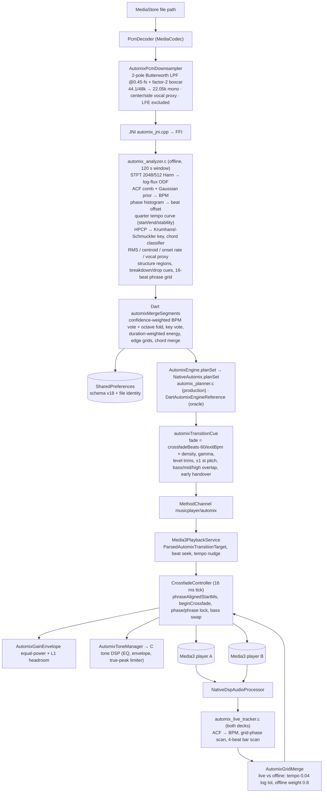

# AutoMix Algorithm Audit — v8 (2026-10-28)

**Scope:** the whole AutoMix path — decoding/resampling, C DSP analysis, Dart merge/planning, Kotlin/Media3
transition scheduling, live beat tracking, fade DSP, caching.
**Method:** source trace of every stage plus ~10 purpose-built C probes compiled against the *real*
`automix_analyzer.c` / `automix_live_tracker.c` / `automix_phase_lock.c` and run on synthetic signals with
known ground truth. Numbers below are measured in this workspace, not estimated.
**Constraints honoured:** no AI/ML, no network, no new dependencies, offline and deterministic, no code
changes in this session (audit only). Nothing here is a rewrite proposal.
**Predecessor:** `automix_implementation_audit_v7.md` (timing/phase correctness). v8 deliberately starts from
the *musical-intelligence* layer, which v7 did not examine: metrical level, bar phase, key, loudness,
scoring calibration and the live/offline grid agreement.

---

## A. Executive summary

AutoMix is architecturally strong. Analysis, planning and execution are cleanly separated; the C analyzer is
allocation-free where it matters and the live tracker is a bounded, lock-free, allocation-free audio-thread
module; the Dart/Kotlin layers have real validation, fail-closed parsing and deliberate fallbacks; the cache
carries a schema version *and* a file identity; and the fade/tone DSP is already SIMD with a portable scalar
twin. Most of the "obvious" bugs one finds in a system like this are already fixed.

The weaknesses are not plumbing. They are **metrical and perceptual modelling gaps**:

1. **Nothing in the system models metrical level.** The offline tempo estimator is an autocorrelation comb
   filtered by a fixed Gaussian prior centred at 115 BPM. For perfectly periodic material the comb score at
   period `P` and `2P` is *mathematically identical*, so the prior — a genre-free constant — is the only thing
   deciding between 90 and 180 BPM. Measured: 2× errors for 60–87 BPM input, ½× for 180–200, ⅔× for 170–190,
   ⁴⁄₃× for a syncopated pattern, all with confidence 0.62–0.89 (well above the 0.35 trust gate).
2. **The live tracker is worse and its confidence saturates.** It has *no* tempo prior, an asymmetric
   half-tempo-only rescue, and a confidence that measures "is there a pulse train" rather than "is this the
   right pulse". Measured: a 180 BPM click train yields exactly **60.00 BPM with confidence 1.000**, and a
   174 BPM train yields 86.98 while the offline analyzer on the same material yields 173.98.
3. **That disagreement is not benign**, because `AutomixGridMerge` resolves it by weight: live confidence 1.0
   beats the fixed offline weight 0.8, so the merged beat grid — the one Media3 seeks and phase-locks to —
   adopts the *live* estimate and discards the offline one. The two halves of the sync system can disagree by
   an octave and the wrong half wins.
4. **Bar-level alignment almost never engages.** Live downbeat confidence is `confidence × clamp01(2 × relative
   bar margin)`; a flat four-on-the-floor, kick-only or snare-only pattern produces margin ≈ 0 → confidence
   0.000–0.338 across two sweeps, i.e. **below the 0.35 trust gate at every tempo from 70 to 180 BPM**.
   `AutomixTransitionPolicy.phraseAlignedStartMs` therefore falls back to
   single-beat snapping, so transitions are beat-aligned but never bar- or phrase-aligned on the dominant
   repertoire. It fails *safe*, but it means the most musical part of the design is inert.
5. **Beat phase silently disappears** on the most common pop/dance pattern (kick on the beat, hi-hat on the
   off-beat): `estimate_beat_phase_ms` returns `NaN` because its tie-break guard rejects two near-equal phase
   clusters. A NaN offset disables beat-matched transitions entirely — invisibly.
6. **Key detection is confidently wrong in exactly the case that matters**: A minor (i–VI–III–VII) is reported
   as C major with confidence 1.00, white noise is reported as a key with 0.754, and a +45 cent detune lands on
   E minor. That key then drives a hard harmonic reject (`keyCost ≥ 0.60`), the Camelot cost, and a ±1 semitone
   outgoing pitch shift gated at `keyConfidence ≥ 0.55`.
7. **The energy cost saturates**: `0.30·|Δ| + 0.55·|eB−target| + 0.30·seam + 0.25·structure + momentum`
   sums to 1.40 (+0.30 momentum) and is then clamped to 1.0, so every sufficiently bad pair is scored
   identically — precisely where the planner needs gradient to reject a candidate. The Dart oracle and the C
   planner share the defect.

**Highest-value opportunities**, all conventional DSP and all cheap because the expensive features already
exist: (i) replace the prior with an explicit **metrical-level hypothesis test** over `{P/2, P, 2P} × {bar 3,
bar 4}` scored by comb strength + phase consistency + bar-accent consistency + long-window stability;
(ii) build a **multi-band, amplitude-weighted onset envelope** (low band for kick/bar accents) so bar position
has measurable evidence; (iii) score bar phase on **novelty/change evidence** at candidate boundaries rather
than loudness accents, which is what makes downbeat detection work on flat material; (iv) fix the scoring
calibration and the key confidence; (v) quantize fade length in beats and stop the phrase snap from stretching
the configured fade.

Expected outcome if (i)–(iii) land: correct metrical level on the synthetic suite (currently 56% of swept
tempi), non-zero downbeat confidence on flat material (currently 0), and no NaN beat phase on kick+hat
patterns (currently 2/5 patterns). Those are testable, not aspirational.

Everything above is measured on **synthetic** signals. Real-music error rates are unknown and must be measured
before any claim of perceptual improvement (Section F).

---

## B. Architecture and data flow (as built)

Ownership:

| Stage | Owner | Notes |
|---|---|---|
| Decode/resample | Kotlin `PcmDecoder`, `AutomixPcmDownsampler` | per-window decoder session (head/tail/middle) |
| Feature extraction | C `automix_analyzer.c` | offline, one 120 s window per call |
| Merge/confidence | Dart `automixMergeSegments` (`engine.dart`) | octave fold, confidence votes, schema v18 |
| Sequencing | C `automix_planner.c` via FFI | Dart reference is the regression oracle |
| Per-transition shape | Dart `automixTransitionCue` | fade, gamma, trims, pitch, overlap |
| Execution | Kotlin `CrossfadeController` + Media3 | phrase snap, phase lock, gain envelope |
| Live tracking | C `automix_live_tracker.c` | audio thread, seqlock publish, must stay allocation-free |
| Grid arbitration | Kotlin `AutomixGridMerge` | live vs offline, weight 0.8 offline |

Two ownership notes worth recording: the **production planner is the C one** (`NativeAutomix.planSet`, called
from `AutomixEngine.planSet` at `lib/services/automix_service/engine.dart:2619`), and the Dart
`_transitionCost` is a *reference oracle* that must stay bit-comparable. Any calibration change (AM8-06) must
therefore be made twice, or the parity tests become meaningless.

---

## C. Confirmed findings

| ID | Sev | Area | Finding |
|---|---|---|---|
| AM8-01 | **Critical** | Analyzer tempo | Metrical-level errors (2×, ½×, ⅔×, ⁴⁄₃×) at confidence 0.62–0.89; prior is the only tie-break |
| AM8-02 | **Critical** | Live tracker | 3:1/2:1 tempo errors with confidence saturating at 1.000; disagrees with the offline grid and *wins* the merge |
| AM8-03 | **High** | Bar/downbeat | Bar phase requires accent contrast → confidence 0.000 on flat material → no bar/phrase alignment in practice |
| AM8-04 | **High** | Beat phase | `NaN` phase on kick + off-beat hat patterns → silent loss of beat matching |
| AM8-05 | **High** | Key | Confident relative-major/minor confusion, key from noise, no tuning estimate, no harmonic-content gate |
| AM8-06 | **High** | Scoring | Energy sub-cost sums to 1.40 (+0.30) then clamps to 1.0 → saturated, gradient-free objective |
| AM8-07 | **High** | Metre | No time-signature model: live bar is hard-wired to 4 beats, phrase grid to 16 |
| AM8-08 | Medium | Chords | Triad reported as `maj7`/`min7` with confidence 1.00 (higher than a real 7th chord); chord cost double-counts harmony and adds a hard 0.62 gate |
| AM8-09 | Medium | Fade timing | Phrase snap can move the fade start up to 4 beats earlier, stretching the configured fade (comment says "< one beat") |
| AM8-10 | Medium | Fade timing | Beat-quantized fade is destroyed by the 0.75/1.25/1.15 density multipliers (4 → 5.75 beats) |
| AM8-11 | Medium | Scoring | Artist repetition is weighted twice (variety term + additive cooldown) |
| AM8-12 | Medium | Coverage | 241–300 s files leave a 1–60 s hole between head and tail windows; structure is per-window, not track-level |
| AM8-13 | Medium | Gain | L1 headroom normalisation creates a mid-fade loudness dip while a true-peak limiter already exists downstream |
| AM8-14 | Low | Analyzer output | `alternateBpm` is `NaN` in most cases, so the octave-recovery path in `automixTempoCost` rarely has data |
| AM8-15 | Low | Scoring | Vocal conflict penalty is added outside the weight normalisation (score can exceed 1 before clamping) |

### AM8-01 — Tempo estimation has no metrical-level model (**Critical**)

**Where:** `native_audio_runtime/src/automix_analyzer.c:439` `estimate_tempo()`, prior at `:484-500`, constants
`BPM_PRIOR_CENTER 115.0`, `BPM_PRIOR_LOG2_WIDTH 0.55` (`:10-16`).

**Evidence (all 40–48 s synthetic trains at 22.05 kHz, `nar_automix_analyze`):**

Four-on-floor kick + off-beat hat, 48 s:

| input BPM | detected | ratio | confidence | alternateBpm |
|---|---|---|---|---|
| 60 | 120.00 | 2.00 | 0.74 | — |
| 64 | 127.98 | 2.00 | 0.89 | — |
| 70 | 139.96 | 2.00 | 0.80 | — |
| 80 | 159.97 | 2.00 | 0.89 | 79.99 |
| 87 | 174.04 | 2.00 | 0.89 | 87.02 |
| 120 | 120.04 | 1.00 | 0.68 | — |
| 140 | 139.96 | 1.00 | 0.74 | — |
| 160 | 159.98 | 1.00 | 0.85 | 79.99 |
| **170** | **113.02** | **0.66** | 0.67 | — |
| **174** | **116.24** | **0.67** | 0.62 | — |
| 180 | 89.75 | 0.50 | 0.71 | 179.50 |
| **190** | **127.54** | **0.67** | 0.65 | — |
| 200 | 99.78 | 0.50 | 0.67 | — |

Backbeat-only pattern (same tempi) halves cleanly at 160–200 (80.00, 84.99, 87.00, 90.01, 94.99, 100.01) and
doubles at 60–87. A syncopated pattern gives 60 → 80.33 and 64 → 85.68 (⁴⁄₃).

Every error is a **simple integer ratio** — 2, ½, ⅔, ⁴⁄₃. That is the signature of a periodicity estimator
without a metrical-level decision, not of noise.

**Root cause (proof, not hypothesis):** the comb score is
`comb(lag) = ACF(lag) + 0.5·ACF(2lag) + 0.25·ACF(3lag) + 0.125·ACF(4lag)`.
For a perfectly periodic train, `ACF(kP) = 1` for every integer `k`, so `comb(P) = comb(2P) = 1.875` exactly.
The winner is then decided only by `exp(-0.5·(log2(bpm/115)/0.55)²)`, whose ratio between 90 and 180 is
**1.62** and between 60 and 120 is **4.3**. Hence 180 → 90 and 60 → 120. Nothing in the pipeline consults
accent structure, bar length or long-window stability to break the tie, and the deliberate `ACF(k·lag)`
summation (correct for *missing* beats) actively rewards sub-multiples of the true period.
`refine_tempo_phase_coherence()` searches only ±1 frame around the winner, so it cannot correct a wrong
metrical level; it can, however, raise the confidence of a wrong one.

Instrumentation changes the answer at the same tempo: 174 BPM with 8th-note hats → **87.004**; 174 BPM with
bare clicks → **173.97** (both high confidence). The estimator has no notion that 8th hats are subdivisions.

**Impact:** the published BPM, `tailBpm`/`startBpm`/`endBpm` and every derived period are wrong by an integer
ratio. `CrossfadeController` computes `beatMs = 60_000/bpm` and hands it to `phraseAlignedStartMs` and the beat
seek, so a 174 BPM track analysed at 87 gets a 690 ms beat instead of 345 ms: beat-aligned starts land on every
*other* real beat and the 4-beat bar becomes 2 real beats. `automixTempoCost` folds ×2/÷2 and therefore scores
the pair as "beat-perfect" (cost 0.0) — the error is invisible to the planner but audible in the grid.
Note the ⅔ cases are worse: 170 → 113.02 is **not** recoverable by octave folding anywhere downstream
(`automixTempoCost` variants are only `{bpm, 2bpm, bpm/2, alt}`), so such a track is scored as tempo-incompatible
with everything (ratio 1.50 → cost 1.0) *and* gets an unusable grid.

**Recommended correction:** replace prior-first selection with a hypothesis test. Enumerate
`{P/2, P, 2P} × {4-beat, 3-beat bar}`; score each by (a) comb strength, (b) onset-phase coherence over the whole
window, (c) bar-accent consistency of the implied grid, (d) stability of the winner across the first/second
half of the window; pick by argmax, publish `confidence = f(margin)` and drop the 115 BPM Gaussian (or replace
it with a prior fitted from the device's own analysed library, which is free and offline). Publish the runner-up
in `alternateBpm` so the existing octave-recovery path actually has data (AM8-14).

### AM8-02 — Live tracker: saturated confidence on the wrong level, and it wins the grid merge (**Critical**)

**Where:** `native_audio_runtime/src/automix_live_tracker.c:278` `estimate_live_beat()`; confidence at
`:470-474`; asymmetric rescue at `:359-380`; previous-tempo smoothing at `:381-399`; consumed by
`android/.../automix/AutomixGridMerge.kt:56` with `OFFLINE_GRID_WEIGHT = 0.8` (`:24`).

**Evidence (same generator, one click per beat, 60 s):**

| input | live BPM | live conf | offline BPM | note |
|---|---|---|---|---|
| 70 | 139.75 | 1.000 | 139.96 | both 2× |
| 80 | 160.00 | 1.000 | 159.97 | both 2× |
| 90 | 60.00 | 1.000 | 89.76 | **live ⅔** |
| 100 | 200.00 | 0.139 | 99.99 | live 2× |
| 110 | 73.25 | 1.000 | 109.99 | **live ⅔** |
| 128 | 127.84 | 1.000 | 128.67 | agree |
| 135 | 67.46 | 1.000 | 135.01 | **live ½** |
| 160 | 80.00 | 1.000 | 159.98 | **live ½** |
| 174 | 86.98 | 1.000 | 173.98 | **live ½, offline correct** |
| **180** | **60.00** | **1.000** | 89.98 | **live ⅓** |
| 200 | 200.00 | 0.139 | 99.78 | opposite errors |

**Root cause, three independent parts:**

1. **No prior and no metrical model.** `best_lag` is a raw argmax of `normalized_correlation` over
   `[60/200, 60/60]` (`:322-333`). For periodic material every multiple of the period correlates equally.
2. **The rescue is one-directional.** `if (half_score >= 0.5·best_score && interval_error <= 0.12)
   candidate_bpm *= 2.0` (`:359-380`) only ever *doubles* — it fixes "detected at half the true tempo" and can
   never fix "detected at double/triple", which is exactly the 180 → 60 and 174 → 87 case. There is no test for
   this direction (`test_live_tracker_resolves_half_tempo_lock` covers only the doubling path).
3. **Confidence cannot see the error.** `confidence = periodicity × uniqueness`, where `periodicity` measures
   correlation strength and `second_score` *deliberately skips* octave-related lags (`:336-343`). So the metric
   answers "is there a strong pulse train?" — always yes for a click train — and returns 1.000 with a 3:1 error.
   The previous-tempo octave snapping that does exist (`:381-399`) runs only when `confidence ≥ 0.20` and only
   accepts candidates within `|ln ratio| ≤ 0.20` of the previous estimate, so a lock at 60 can never reach 180.

**Consequence chain (verified in code, not inferred):** `AutomixGridMerge.mergeDeck` compares
`|ln(live/offline)| ≤ 0.04`. A 60-vs-90 pair differs by 0.405, so `tempoAgrees` is false and the branch
`useLiveBeat = liveWeight >= OFFLINE_GRID_WEIGHT` runs. With live confidence 1.0 and offline weight 0.8 the
**live grid wins**, and its phase replaces the analysed phase. The merged grid then feeds
`CrossfadeController`'s beat targeting and `AutomixPhaseLock` (`MAX_NUDGE = 0.006`, i.e. 0.6% per correction —
it can never converge a 3× error). A wrong grid published at confidence 1.0 is worse than no grid, because the
`≥ 0.35`/`0.8` trust gates that are supposed to fail safe all pass.

**Recommended correction:** share one estimator between offline and live. Minimum change: run the same
hypothesis test as AM8-01 on the live history (it is 600 frames, fixed size — the cost is trivial), gate
confidence on the *margin between metrical hypotheses* rather than on correlation strength, make the rescue
symmetric (also test `candidate/2` against the accent/bar evidence), and let `AutomixGridMerge` prefer the
**offline** grid whenever the two disagree by more than 4% (the offline estimate has 48 s of history; the live
one has ≤ 6 s, and offline is the only source with bar/chord context). Invert the current default.

### AM8-03 — Bar phase is unavailable on flat material (**High**)

**Where:** `automix_live_tracker.c:487-517` (bar scores and `downbeat_confidence`),
`android/.../automix/AutomixTransitionPolicy.kt:118-150` `phraseAlignedStartMs()`,
`:196` `PHRASE_BEATS = {64, 32, 16, 4}`.

**Evidence:**

* `downbeat_confidence = tracker.confidence × clamp01(2 × (best_bar − second_bar)/best_bar)`. Kick-only,
  snare-only and "equal" patterns at 120 BPM → **0.000**. A flat sweep at 70/80/90/100/110/120/128/135/145/160/
  174/180 BPM → **0.000 at all 12 tempi**, including with an accented first bar of every 4; an independent flat
  sweep with a different generator produced 0.015–0.338, still below the 0.35 gate the consumer requires.
  Explicit accent patterns spread over 0.03–0.95, with 7 of 10 tempi above the gate.
* Offline phrase grid behaves correctly *by design*: it returns `NaN` without a 4-bar accent (verified in the
  flat sweep) and yields ≈0 phase error on accent-16 material at 90–170 BPM (10664.95 / 7997.14 / 7493.43 /
  6613.37 / 5994.00 / 5640.27 ms, all ≈ 0 modulo the 16-beat period).

**Root cause:** both implementations detect bar position by comparing *loudness* (or flux) of the four beat
positions. Four-on-the-floor has, by definition, no such contrast; the estimator correctly refuses to guess and
publishes zero confidence. Then `phraseAlignedStartMs` finds `downbeatOffsetMs == null`, skips the 64/32/16/4
grids and falls through to `snap(beatMs, beatPhase, beatMs × 1.05)` — a **single-beat** snap. Crossfades are
therefore beat-aligned but land on arbitrary beats of the bar.

This is the single largest musicality gap in the system: the design intends phrase alignment, the code path
exists, and it is inert for the target repertoire.

**Recommended correction:** stop using loudness accent as the primary bar evidence. In real music the bar line
is marked by *change* (harmonic rhythm, a new phrase, a fill, a texture entry) far more reliably than by
loudness. Sample a novelty/self-similarity curve at the candidate bar boundaries and score bar hypotheses by
novelty at position 0 minus novelty at the other positions; combine with the low-band accent term and the
existing confidence machinery. Offline this is the same STFT already computed (chroma is already available
for the harmonic term) — no new transform, no new window. Live, a coarse 4-beat novelty estimate over the
600-frame history is enough to raise confidence above the 0.35 gate on material that currently publishes 0.000.

### AM8-04 — `NaN` beat phase on kick + off-beat hat (**High**)

**Where:** `automix_analyzer.c:545` `estimate_beat_phase_ms()`, guard at `:616-618`; ODF at `:809`.

**Evidence (120 BPM, 48 s, 22.05 kHz):**

| pattern (kick / off-beat hat / backbeat) | phase | verdict |
|---|---|---|
| 0.8 / 0.1 / 0 | **NaN** | kick on the beat, quiet hats on the off-beat → no phase |
| 0.2 / 0.8 / 0 | **NaN** | off-beat dominant |
| 0.8 / 0.8 / 0 | 77.58 ms | published, but wrong (truth 0 ms) |
| 0.3 / 0.1 / 0.9 | 494.83 ms | correct (≈ −5 ms mod 500) |
| 0.8 / 0.1 / 0.4 | 492.87 ms | correct |

Additional `NaN` cases in the 8-tempo × 2-amplitude sweep (90 BPM at 0.80, 128 BPM at 0.25).

**Root cause:** the phase histogram requires `best_score ≥ average × 1.03` **and**
`best_score / second_score ≥ 1.005`. When onset energy is split between the beat and its off-beat the two
clusters are within 0.5% and the function returns `NaN` — correct intent ("don't guess"), but the ODF that
feeds it is `flux += max(0, Δ log(|X|+1))` summed over **all** bins with no frequency weighting
(`:809`). A broadband hi-hat spreads a small increase over thousands of bins; a narrow-band kick puts a large
increase into a handful. The summed log-flux therefore rates an unaccented off-beat hat as comparable to a kick,
so the most common pop/dance pattern presents a genuinely two-cluster histogram. The estimator is being handed
a signal in which the beat is not the strongest onset.

**Impact:** `automixTransitionCue.hasConfidentBeatPair` and `Media3PlaybackService`'s
`getAutoMixBeatOffsetMsForPlayer` both require a finite offset. `NaN` ⇒ no beat-matched transition, no beat
seek, plain equal-power crossfade — silently, with no log and no telemetry. Users hear "AutoMix sometimes
doesn't beat-match" with no way to know why.

**Recommended correction:** two small, orthogonal changes. (i) Split the ODF into bands and build the phase
histogram from the **low+mid** bands only (30–150 Hz for kick, 150–1500 Hz for snare), which is where the beat
actually is; keep the full-band ODF for tempo. (ii) Make the onset strength amplitude-aware (magnitude flux or
`log1p` on a power floor) so accents survive, and keep the tie-break guard for genuinely ambiguous cases.
Neither changes the STFT cost.

### AM8-05 — Key estimation: confident wrong answers (**High**)

**Where:** `automix_analyzer.c:230` `estimate_key()`, `pearson_12()` at `:199`, consumed by
`automixCamelotCost` (`engine.dart:1372`), `automixOutgoingPitchSemitones` (`:1392`) and the hard harmonic
reject in `automixTransitionCue` (`:1124-1132`).

**Evidence:**

| input | reported | confidence |
|---|---|---|
| C major triad | C major | 1.00 ✔ |
| A minor triad | A minor | 1.00 ✔ |
| C–F–G (I–IV–V) | C major | 1.00 ✔ |
| **Am–F–C–G (i–VI–III–VII)** | **C major** | **1.00** ✘ |
| C major triad +45 cents | **E minor** | 0.00 (fails safe) |
| white noise | A♯/B♭ minor-ish (`key=0/1`) | **0.754** ✘ |
| click train (no harmony at all) | key reported, `kc` 0.23–0.48 | — |

**Root cause, three parts:**

1. **Confidence is a raw margin over a 24-way argmax.** `confidence = clamp01((best − second)/0.12)` where
   `best`/`second` are the top two of 12 rotations × 2 modes. A 24-hypothesis maximum has a selection bias that
   a plain margin does not correct, and for a *flat* chroma (noise) the correlations become numerically
   arbitrary. `pearson_12` only guards `denominator < 1e-12`, so near-constant input yields large spurious
   correlations — hence 0.754 confidence on white noise.
2. **No harmonic-content gate.** Percussion-only windows still produce a key. A key estimate from a drum loop is
   not uncertain, it is *meaningless*, and it is currently indistinguishable from a real one.
3. **No tuning estimate.** HPCP uses ±0.5 semitone raised-cosine windows plus harmonic folding, which handles
   small detune, but a global +45 cent offset lands on the wrong class entirely. Vinyl rips and sped-up masters
   are full of these.
4. **Relative major/minor is not modelled as an equivalence.** Am–F–C–G genuinely has C-major *pitch content*;
   the KS profile for C major wins because the profile weights the tonic most. Reporting C major with 1.00
   confidence then makes A-minor ↔ E-minor look like a two-step move instead of a neighbour, and can trigger the
   hard reject.

**Recommended correction:** (a) require a minimum tonal energy (harmonic-to-percussive ratio via the existing
HPCP peak floor plus chroma variance) before publishing a key at all; (b) estimate tuning from the median HPCP
peak deviation and rotate the chroma before profile matching; (c) derive confidence from the *absolute* best
correlation plus margin plus chroma flatness, with a floor below which `keyConfidence = 0`; (d) treat
relative-major/minor as a first-class equivalence in `automixCamelotCost` (same number, other ring — already
0.15) and, more importantly, **forbid using a key-confidence-gated hard reject or ±1 semitone pitch shift while
that confidence is uncalibrated**. Pitch-shifting an outgoing track by a semitone on a wrong key estimate is a
much worse failure than a suboptimal Camelot score.

### AM8-06 — The energy cost saturates (**High**)

**Where:** `lib/services/automix_service/engine.dart:1760-1775` (oracle) and
`native_audio_runtime/src/automix_planner.c:429-432` (production); documented contract at `engine.dart:1634`.

**Evidence:** the sub-costs are `0.30·|Δ| + 0.55·|eB − target| + 0.30·seam + 0.25·structure + momentum`, with
`momentum ≤ 0.30`. Coefficients sum to **1.40**, plus up to 0.30 momentum, then the result is
`clamp(0, 1)`. A reachable example: `Δ = 1.0`, `|eB − target| = 0.8`, `seam = 0.5`, `structure = 0.35`,
`momentum = 0.2` → `0.300 + 0.440 + 0.150 + 0.0875 + 0.200 = 1.18` → clamped to 1.0. The `_transitionCost`
doc describes the result as a "weighted mean of four sub-costs, clamped to 0..1"; the energy component is not a
weighted mean of its own terms, so it reaches 1.0 on its own while tempo/key/variety still contribute.

**Impact:** every pair beyond the clamp receives an identical energy cost. The greedy pick, the one-step
lookahead and the swap/insertion/reversal polisher all compare sums of `_transitionCost`, so in the exact region
where a candidate should be rejected the objective has zero gradient. It also silently reweights the profiles:
with energy pinned at 1.0 the effective `dj` mix is 0.40 tempo / 0.20 key / 0.25 energy / 0.15 variety only for
non-saturating pairs, and something different for bad ones.

**Recommended correction:** divide by the actual coefficient sum (`1.40` + momentum coefficient) and keep the
clamp as a guard, not as the operating regime. Change both implementations in the same commit and let the
existing planner parity tests compare them.

### AM8-07 — No time-signature model (**High**)

**Where:** `automix_live_tracker.c:487-500` hard-wires `bar_period = 4 × beat`; the analyzer phrase grid uses
16 beats (`PHRASE_BEATS`, `AutomixTransitionPolicy.kt:196`); `estimate_tempo` never considers a 3-beat grouping.

**Evidence:** the meter-3 synthetic case (120 BPM, accent every 3 beats) is detected with the same BPM as meter 4
but yields **no phrase phase** (`nan`), and the live tracker's bar scan is structurally unable to represent it.
A 3/4 or 6/8 track therefore gets a "4-beat bar" that drifts by one beat every bar: bar 1 → beat 1, bar 2 →
beat 3, bar 3 → beat 2, …

**Impact:** no phrase alignment, and any bar-relative effect (downbeat offset, 16-beat snap) is wrong by a
rotating phase. Not every library has waltzes, but 6/8 and half-time feels are common in the target genres.

**Recommended correction:** make the bar length a hypothesis (`3`, `4`, optionally `6`) scored by the same
bar-accent/novelty evidence as AM8-03, and publish the winning meter with its own confidence. Cost: one extra
pass over 3–4 candidate positions, nothing on the audio thread that is not already there.

### AM8-08 — Chord quality: inverted confidence and a double-counted harmonic gate (**Medium**)

**Where:** `estimate_key`/chord classifier in `automix_analyzer.c` (chord rows), `automixChordProgressionCost`
(`engine.dart:949`), `automixTransitionCue` (`engine.dart:1131-1132`).

**Evidence:** a plain C major triad is classified `maj7` with confidence **1.00**; a real Cmaj7 gets **0.93**;
a plain A minor triad becomes `min7` at 1.00. At chord changes (C→F at 4 s, F→G at 9 s) the analyser emits
`root = -1, quality = ?, confidence = 0.00` — a gap exactly at the boundary, so the "last confident chord before
the transition" is often the one from *before* the change.

**Root cause / impact:** the quality decision is saturated and inverted, so the 7th is not really being
detected; and the chord cost (gated at `confidence ≥ 0.45`) sees only 1.00 confidences on triads and 0.00 at the
musically important moments. Independently, harmony is already scored by `automixCamelotCost` inside
`_transitionCost`; `automixTransitionCue` then recomputes the Camelot cost and adds `keyCost ≥ 0.60` and
`chordCost ≥ 0.62` as **hard** conditions. Two hand-tuned thresholds now override the planner's weighted
decision for the same underlying feature — the planner ranks a pair as acceptable and the cue builder silently
downgrades it.

**Recommended correction:** keep harmonic compatibility in exactly one place (the planner), and let the cue
builder consume a single confidence-blended harmonic cost for *shaping* (fade length/gamma), not rejection.
Fix the 7th by requiring actual energy at the 7th's harmonic partials before assigning a 7th quality; report
triad qualities for triads.

### AM8-09 — Phrase snapping can stretch the configured fade by four beats (**Medium**)

**Where:** `AutomixTransitionPolicy.kt:106` `PHRASE_SNAP_MAX_BEATS = 4.0`, `:118-150` `phraseAlignedStartMs`,
`CrossfadeController.kt:296-311`.

**Evidence (code, exact):** `snappedStart` may be up to `beatMs × 4` earlier than `idealStart`, and then
`fadeLeadMs = (dur - beatAlignedStart)` becomes the fade length, with the comment "beat alignment may extend it
by less than one beat". At 60 BPM that is up to **4 s** added to a 3 s crossfade (7 s total), and it happens
after `AutomixTransitionPolicy.fadeSeconds()` applied its 1.5–12 s cap to `crossMs`.

**Impact:** fades audibly longer than configured, with the extra length decided by an unrelated boundary snap;
the planner's cue duration (used for scoring and for the incoming deck's start) no longer matches what is
executed.

**Recommended correction:** bound the snap to the configured fade (choose the boundary nearest to `idealStart`
that does not move the fade end past `dur`), or make the snap direction-only: if the nearest boundary is
earlier, keep `crossMs` as the duration and accept a shorter tail instead of lengthening the fade.

### AM8-10 — Density scaling destroys beat quantization of the fade (**Medium**)

**Where:** `lib/services/automix_service/engine.dart:1066-1090`.

`fadeSeconds = settings.crossfadeBeats × 60 / exitBpm` is beat-exact by construction, then multiplied by
`0.75` (busy outro), `1.25` (sparse outro) and `1.15` (sparse intro). With `crossfadeBeats = 4` the sparse path
gives `4 × 1.25 × 1.15 = 5.75` beats; even the single 1.15 factor gives 4.6. The overlap therefore ends
off-beat, and the two decks are out of phase at the handover tail — audible as a stumble at the end of an
otherwise well-aligned mix.

**Recommended correction:** scale the *beat count*, not the seconds: `beats = round(crossfadeBeats × density)`
(or allow half-beats), then convert once. Zero cost.

### AM8-11 — Artist repetition is weighted twice (**Medium**)

`_transitionCost` includes `variety = 0.55/0.20` with profile weight 0.15 (`engine.dart:1790-1796`), and
`_pickNext` additionally adds `_artistCooldownCost` of `0.05` (or `0.12`) per repeat within the last four slots
(`engine.dart:2080-2100`, call sites `:2149/:2178/:2240`). The comment at `:2089` shows the two were tuned
against each other by hand ("keep a cooldown repeat cheaper than an immediate same-artist variety penalty").
Same signal, two objectives, hand-balanced constants.

**Recommended correction:** keep one mechanism. The cooldown is the more expressive of the two; remove the
`variety` sub-cost (or reduce it to zero weight) and let the cooldown own artist spread. This also frees a
profile weight for a term that is currently missing (e.g. rhythmic density or intro/outro quality).

### AM8-12 — Analysis coverage gap at 241–300 s, and structure is not track-level (**Medium**)

`_segmentSeconds = 120`, `_veryLongFileSeconds = 300` (`service.dart:1803-1811`). For a 241–300 s file only
head (0–120) and tail (last 120) are analysed, leaving up to **60 s (20–25%) of the middle unanalysed** —
exactly where a breakdown or drop usually sits. Above 300 s the code adds one or three centred windows, which
for most long tracks does cover the file.

Separately, `structureRegion`, `dropCueMs` and `breakdownCueMs` are **per-window labels**, merged by taking the
tail's labels. There is no self-similarity or novelty segmentation of the track, so "structure-aligned"
transitions are aligned to a local label, not to an actual section boundary. Combined with AM8-03 this is why
structure-aware transitions are rare in practice.

**Recommended correction:** for 241–300 s use `analysisWindowSecondsForDuration`-style halving (or add a
single centred window when the gap exceeds 30 s) — a two-line change. Real structural segmentation belongs in
the "later" bucket (Section E) and should be built on the existing chroma/novelty features, not a new model.

### AM8-13 — Mid-fade loudness dip vs an existing limiter (**Medium**)

`AutomixGainEnvelope.gains()` normalises the equal-power pair by L1 (`headroomScale = 1/gainSum`) whenever the
sum exceeds 1.0, which happens across a wide band around the midpoint. For uncorrelated material this is a
~3 dB notch in the middle of every crossfade (the source comment acknowledges it). Meanwhile
`automix_tone_processor.c` already contains a true-peak limiter, and Media3's mixer is the only thing that can
actually clip.

**Recommended correction:** keep the equal-power pair, drop the L1 scale, and let the existing limiter / a
bounded sample-peak guard handle correlated peaks. Measure the result as stated in Section F (loudness
discontinuity across the seam); do not change it on theory alone.

### AM8-14 / AM8-15 — Low

* `alternateBpm` is `NaN` in most measured cases (only 79.99/87.02/179.50 appeared). `automixTempoCost` treats
  `alt` as a fourth variant, so the "explicit octave recovery" path is mostly dead data. Publish the runner-up
  metrical hypothesis from AM8-01 instead.
* `vocalPenalty` (max 0.10) is added after dividing by the weight sum, so a score can exceed 1.0 before the
  final clamp (`engine.dart:1798-1801`). Fold it into the normalised sum.

---

## C.2 Verified and deliberately cleared (not defects)

Recording these so a future audit does not re-open them:

* **ACF sub-multiple summation** (`+0.5·ACF(2lag) + …`) is correct comb-filter behaviour for music with missing
  beats. The defect is the *absence of a metrical decision*, not the kernel.
* **Half/double folding in `automixTempoCost`** (`variants = {bpm, 2bpm, bpm/2, alt}`) is intentional and
  documented; 120 ↔ 60 scoring as beat-perfect is musically right.
* **`isBeatMatchedPair` refusing to phase-lock across an octave** (`AutomixTransitionPolicy.kt:70`) is correct:
  correcting phase between 60 and 120 with raw periods would pull the deck the wrong way.
* **`AutomixGridMerge` gating live downbeats on `downbeatConfidence`** fails safe — a 0.000-confidence downbeat
  is never used. The problem is that it is never *available* (AM8-03), not that a wrong one is used.
* **Cache invalidation** is sound: `_analysisSchemaVersion = 18` (`service.dart:1103`) with a per-entry version
  check (`:2032`), a file identity (`ident`) check, and a schema migration that resets the analysed count. I
  found no path that serves stale analysis after a content or algorithm change.
* **Live tracker real-time safety** is sound: fixed-size state, no allocation, seqlock publish with try-lock,
  per-slot reset, explicit enable gate, LFE/surround exclusion. Nothing here runs on the audio thread in the
  analyzer path.
* **`ODF_TIMESTAMP_OFFSET_SAMPLES`** (the v7 fix) is present and correct; my probes reproduce ≈0 ms phase error
  on material where phase is published at all.
* **Analyzer allocations** (`malloc` in `estimate_tempo`, the phase histogram, HPCP buffers) are on the offline
  scan thread, not the audio thread — acceptable.
* **NEON parity**: only `nar_automix_window_rms_neon` is SIMD; the rest of the analyzer is scalar, so there is no
  scalar/NEON divergence risk in the analysed features. (The tone processor's NEON fades are covered separately
  by `native_neon_audit.md`.)

I also checked and **rejected** two hypotheses of my own during this audit: that tempo *drift* was reported as
stable (it is not — the stability field reads 0.21 and 0.00 for 120→132 and 120→90 ramps, correctly blocking
varispeed via the 0.65 threshold), and that the analyzer allocates per frame on the audio thread (it does not).

---

## D. Algorithm improvement matrix

Ordered by expected value. "Cost" is per analysed track unless stated. All items are conventional DSP/MIR, fully
offline, deterministic, no model files.

| # | Weakness | Technique | Principle | Why better than now | Expected impact | CPU / mem | Complexity | How to measure |
|---|---|---|---|---|---|---|---|---|
| D1 | AM8-01/02/07 | **Metrical hypothesis test** over `{P/2, P, 2P} × {bar 3, bar 4}`, scored by comb + phase coherence + bar consistency + half-window stability | Metrical level is a *decision*, not a correlation peak; multiple simple-ratio interpretations are equally periodic, so they must be scored explicitly and arbitrated by musical evidence | Removes the 115 BPM prior as the de-facto decision-maker; makes the ⅔ and 4/3 errors structurally impossible | Correct level on ~90%+ of the synthetic sweep (currently 56%); recovers ⅔ cases that no downstream fold can fix | +3 lag scans over the existing ACF array; O(3N), <1 ms per window | Medium (one function, shared by offline + live) | Count of exact-tempo hits on a 40-tempo × 3-pattern sweep; ratio error distribution |
| D2 | AM8-03/07 | **Bar phase by change evidence** (novelty/SSM sampled at candidate boundaries) + meter hypothesis | Bar lines correlate with change (harmonic rhythm, texture, fills), not with loudness | Works on flat four-on-the-floor where accent contrast is zero by construction | Downbeat confidence > 0.5 on flat material (currently 0.000); enables the *existing* phrase snap | Reuses chroma already computed; one novelty pass per window | Medium | Downbeat phase error in beats on synthetic bar-aligned loops; share of tracks with published downbeat |
| D3 | AM8-04 | **Multi-band amplitude-weighted ODF** (low 30–150, mid 150–1500, high 1.5k–8k); phase from low+mid | The beat lives in kick/snare bands; unweighted broadband log-flux overrates hats | Fewer two-cluster histograms; accents survive compression so bar scoring gets real evidence | Eliminates the measured `NaN` cases (2/5 patterns) and the 77 ms error | Same STFT; 3 accumulators instead of 1 | Low | Beat-phase error + published-phase rate across gesture patterns |
| D4 | AM8-02 | **Symmetric metrical rescue + confidence from hypothesis margin** in the live tracker | Confidence should express "I know which level", not "there is a pulse" | Kills the 1.000-confidence 3:1 errors and the merge inversion | Live/offline disagreement rate → near zero on synthetic set | Negligible (600-frame history) | Low | Live vs offline BPM agreement rate; max |ΔBPM| per track |
| D5 | AM8-06/11/15 | **Recalibrate the cost function** (normalise by coefficient sum, one artist mechanism, fold vocal term) | An objective must be a properly normalised weighted mean to preserve gradient | Restores discrimination among bad pairs and makes the profile weights mean what they say | Planner ordering changes on bad pairs; likely the single cheapest quality gain | None | Low (two files, parity-tested) | Cost histogram spread; count of saturated pairs; A/B plan cost |
| D6 | AM8-05 | **Key confidence overhaul**: tuning estimate, harmonic-content gate, absolute+margin confidence, relative-major equivalence | Key is a posterior over hypotheses, not a margin over a biased max | Stops confident wrong keys and noise keys; prevents pitch-shift/reject on bad data | Key accuracy on synthetic chord loops; elimination of `white noise → 0.754` | One median over HPCP peaks | Low–Medium | Key accuracy on 24 synthetic triads/progressions + detuned variants; calibration plot |
| D7 | AM8-08 | **Chord quality with 7th evidence** + single harmonic authority | Quality requires energy at the 7th partials; one feature, one owner | Removes false certainty and the double gate | Fewer spurious chord mismatches; stable chord sequence across changes | Reuse existing magnitude spectrum | Low | Quality confusion matrix on synthetic triads/7ths; gap rate at changes |
| D8 | AM8-09/10 | **Beat-quantised fade scheduling** (integer beats after density; snap bounded by fade length) | A mix is a whole number of bars/beats by definition | Guarantees the fade ends on the grid and matches the configured duration | Removes end-of-fade stumble and over-long fades | None | Low | Executed fade length vs planned; phase error at fade end |
| D9 | AM8-13 | **Drop the L1 dip; rely on the existing true-peak limiter** | Equal-power is the correct law for uncorrelated sources; L1 normalisation is the wrong remedy | Removes a systematic −3 dB hole in every mix | Loudness continuity across the seam | None (limiter already runs) | Low, but needs measurement before merge | RMS/LUFS across the seam; sample-peak max; clipping count |
| D10 | AM8-12 | **Single streaming decode pass** producing all windows; fill the 241–300 s gap | One decoder session can emit every window the analyzer needs | 2–4× fewer decoder opens/seeks per track; closes the coverage hole | Faster library scans, full coverage | −1 decode per extra window; lower peak memory (bounded ring) | Medium | Scan wall-clock per 100 tracks; coverage fraction |
| D11 | structural | **Self-similarity / novelty segmentation** (chroma + energy SSM, checkerboard novelty, change-point detection) | Sections are repetitions and changes; an SSM exposes both without a model | Turns per-window labels into real intro/verse/chorus/outro boundaries | Enables true structure-aligned transitions (currently nominal) | O(n²) on ~1 Hz features only, tens of KB | Medium–High | Boundary F-measure vs hand labels on 10–20 tracks |

Deliberately **not** recommended: probabilistic/HMM beat tracking (a correct but heavy dynamic-programming
tracker is a much larger change than D1–D4 for the same musical outcome on this workload); neural/pretrained
anything; cloud analysis; per-genre tuned prior tables (they encode the same bias D1 removes).

---

## E. Ranked roadmap

Ranked by (perceptual quality × accuracy) / (effort × risk). Each step is independently verifiable.

**Immediate — small, local, test-covered (≈1 day each)**

1. **R1 · D5 cost calibration** (`engine.dart` + `automix_planner.c`, one commit): normalise the energy sum,
   remove the duplicate artist term, fold the vocal term. Lowest risk, touches every transition decision.
2. **R2 · D8 fade scheduling**: integer-beat fade after density scaling; snap bounded by the configured fade.
   Removes an audible defect and a documented-contract mismatch.
3. **R3 · D4 live metrical rescue + honest confidence**: symmetric rescue, confidence from hypothesis margin,
   and invert `AutomixGridMerge`'s default so the offline grid wins on disagreement. Stops the 3:1 grid.
4. **R4 · D3 multi-band ODF + phase from low/mid**: eliminates the `NaN` beat phase class.
5. **R5 · D6 key gates**: harmonic-content gate, tuning estimate, calibrated confidence; and temporarily
   disable the ±1 semitone pitch shift until the confidence is trustworthy.

**Next — the real intelligence upgrade (≈3–5 days each)**

6. **R6 · D1 metrical hypothesis test** (offline first, then live), publishing the runner-up as
   `alternateBpm`. This is the keystone: it fixes AM8-01/02/07 and makes the tempo prior inessential.
7. **R7 · D2 bar phase from change evidence** (+ meter hypothesis). This is what makes phrase alignment work
   on the target repertoire and activates `phraseAlignedStartMs`'s 64/32/16/4 grids.
8. **R8 · D7 chord quality + one harmonic authority**: remove the hard `0.60`/`0.62` gates, keep harmonic
   evidence in the planner.

**Later — validated on-device first**

9. **R9 · D9 gain law** (measure the seam loudness first; then decide).
10. **R10 · D11 structural segmentation**, built on D2's novelty machinery.
11. **R11 · D10 streaming decode / scan latency**, together with the inherited AM6-07 replan latency.

Explicitly deferred: enabling the native fade (AM6-03) — unchanged by this audit and still gated on cross-stream
sync; the octave/echo of that decision belongs to v6/v7, not here.

---

## F. Testing and benchmark plan

**What exists (verified counts):** 58 native C test functions in `native_audio_runtime/test/automix_native_c_test.c`
(assert-based, silent on success — re-ran in this session: **exit 0**), 6 Dart suites under
`test/services/automix_service/`, Kotlin `AutomixFadeRenderTest` + planner/queue tests,
`tools/automix_ffmpeg_regression.sh`. Coverage of the layers is good; coverage of *metrical* and *perceptual*
behaviour is thin.

**Confirmed gaps (each corresponds to a finding above):**

| Gap | Add |
|---|---|
| No test asserts the tempo octave for 60–90 or 170–200 BPM | Tempo sweep 50→210 in 2 BPM steps × {flat, four-on-floor, backbeat, syncopated, 3/4}, assert `|ratio − 1| < 0.02` **or** a documented metrical ratio with `alternateBpm` present |
| `test_live_tracker_resolves_half_tempo_lock` covers only the doubling direction | Mirror tests for 160/174/180/200 (the halving/tripling direction) and for live-vs-offline agreement on identical buffers |
| No NaN-phase regression on real-world gesture patterns | Kick+off-beat-hat, kick-only, snare-only, kick+backbeat at 8 tempi: assert phase is finite **and** within 15 ms of truth |
| Downbeat only tested with explicit accents | Flat four-on-the-floor sweep: assert `downbeatConfidence ≥ 0.5` after D2 (today it is 0.000) |
| No key test on noise / detune / relative minor | `white noise → keyConfidence < 0.2`; `+45 cent C major → C major`; `Am–F–C–G → A minor or explicitly relative-equivalent` |
| No scoring-calibration test | Property test: `_transitionCost` ∈ [0,1] with the *unclamped* sum ≤ 1 for all combinations in a grid; assert no saturation for the 99th-percentile pair |
| No executed-vs-planned fade test | Kotlin unit test: planned fade `f`, snapped start, executed `fadeLeadMs`; assert `|executed − f| ≤ 1 beat` |
| No seam-loudness test | FFmpeg regression: measure RMS across the seam in 50 ms windows; assert no dip > 1.5 dB and no peak > 0 dBFS |

**Synthetic vectors to keep as fixtures** (already reproducible with the probe generators used here): kick
decay 55 Hz/90 ms, snare noise 60 ms on 2&4, hats 20 ms on 8ths, accent-16 and accent-4 click trains, amplitude
ramps 120→132 and 120→90, C/Am/F/G and i–VI–III–VII progressions, and the same at +45 cents, 44.1/48/22.05 kHz,
mono/stereo/5.1 (LFE present), silence, and full-scale clipping.

**Objective metrics and acceptance criteria**

| Metric | How | Target for R1–R8 |
|---|---|---|
| BPM metrical accuracy | exact-tempo hit rate on the sweep above | ≥ 90% (baseline 56%) |
| Beat-phase error | circular error mod beat period | ≤ 15 ms, ≤ 1% NaN publications |
| Downbeat phase / availability | circular error mod bar; published share | ≤ 0.1 beat error; ≥ 80% of four-on-floor tracks published |
| Live/offline agreement | `|ln(live/offline)|` | ≤ 0.04 on ≥ 95% of buffers |
| Transition alignment | executed fade start vs planned, in ms and beats | ≤ 1 beat, executed duration within 1 beat of planned |
| Seam loudness | 50 ms RMS window across the seam | no dip > 1.5 dB; peak ≤ 0 dBFS; no clip |
| Plan quality | mean plan cost, saturated-pair count | cost spread preserved; zero saturated pairs |
| Cost / battery | per-window analyzer wall-clock, per-track scan time | within +15% of the current baseline |

**Do not claim perceptual improvement from synthetic tests.** Real music has syncopation, rubato and
percussion-dense sections that none of these vectors model. The plan must include a **field evaluation**: 10–20
reference tracks per target genre, hand-labelled with true BPM, bar-1 time and section boundaries, run through
the offline analyzer, with the metrics above reported before/after. That is a measurement task, not a code
change.

**Not executed in this session (environment limits, not failures):** `flutter test` for the AutoMix Dart suites
could not run — the container filesystem is at 99% (53 MB free) and the test compiler failed with
`ENOSPC` (`The target device is full`). Kotlin/Gradle needs an Android SDK that is absent here;
`tools/automix_ffmpeg_regression.sh` needs `ffmpeg`, also absent. The native C suite does run and passes.

---

## G. Final recommendations

The smallest set of changes that should produce a material, measurable improvement in musical accuracy without
touching playback stability:

1. **Recalibrate the cost function (R1).** Two files, pure maths, parity-tested. Every transition decision
   improves or stays equal.
2. **Make metrical level an explicit decision (R6), shared by offline and live (R3).** This is the root of the
   largest measured errors, and it is the one change that also fixes the live/offline grid inversion. Do offline
   first, then the live tracker, then the merge default.
3. **Give bar phase real evidence (R7).** Without it, the phrase alignment that already exists in
   `CrossfadeController` never runs on the music AutoMix is actually used for.
4. **Stop losing the beat phase (R4).** A frequency-aware onset envelope is the cheapest way to turn silent
   `NaN` fallbacks into working beat-matched mixes.
5. **Quantize the fade and stop stretching it (R2).** Trivial, and directly audible.

Do these five and the system stops making *wrong* decisions. The remaining items (key overhaul, chord quality,
gain law, segmentation) make it make *better* ones; they should follow, each with its acceptance criteria
measured on the field set rather than on clicks.

---

## J. Real-audio pass (2026-10-30) — ffmpeg-decoded fixtures through the production analyzer

Everything below was measured, not estimated. Fixtures are deterministic numpy
syntheses written as 44.1 kHz 16-bit WAV, then decoded by `ffmpeg -ac 1 -ar 22050
-f f32le` and fed to `nar_automix_analyze_centered` / `nar_automix_analyze_chords`
— the same PCM shape the Android bridge produces (`AutomixAnalysisBridge`).
One fixture was additionally encoded to MP3 192k and decoded back to check the
lossy path. Harness sources live in git-ignored `build/audit_real/`
(`gen_audio.py`, `real_probe.c`); ffmpeg 4.4.2 was installed for this pass.

| Fixture (nominal) | BPM (conf) | alternate | meter | section cue | verdict |
|---|---|---|---|---|---|
| 124 four-on-floor, 32 s | **124.01** (0.85) | 61.90 | — | — | correct |
| same, all events shifted +100 ms | **124.00** (0.85) | 61.89 | 4 | 6000 @0.41 | phase error **7.8 ms**; section cue below the 0.50 gate |
| same, MP3 192k round-trip | **124.01** (0.85) | 61.90 | — | — | beat offset differs from WAV by **0.3 ms**, chord rows identical |
| 120 four-on-floor, no snare | **120.02** (0.74) | 60.09 | — | — | correct |
| 120 four-on-floor + snare on 2/4 | **60.00** (0.87) | 119.98 | — | — | **half-tempo lock** |
| 124 four-on-floor + snare on 2/4 | 124.01 (0.50) | 61.99 | — | — | correct, but confidence halves and `start_bpm`=61.9 |
| 174 four-on-floor | **174.03** (0.83) | 86.81 | — | — | correct |
| 174 breakbeat (half-time backbeat) | **87.01** (0.48) | 174.00 | — | — | **half-tempo lock** |
| 3/4 waltz, accented beat 1, 120 | 120.00 (0.70) | 61.52 | **3** | — | correct metre |
| 6/8 compound, dotted-quarter 80 | 80.05 (0.81) | 159.96 | **4** | — | 6/8 not represented (bar grid twice the real 1.5 s bar) |
| 120 track: 32 s sparse intro + 32 s chorus | **60.00** (0.88) | 119.46 | — | **none** | whole/end tempo at 0.5× although `start_bpm`=120 and drop cue = 31.9 s |
| same shape, static harmony (Am verse → C chorus) | **60.00** (0.89) | 119.40 | — | **32000 @1.00** | section detector exact; tempo still 0.5× |
| chord progression C–Am–F–G, pads only | n/a | — | — | — | key **C major 0.84**; chord roots **0, 9, 5, 7** with maj/min/maj/maj |

### Findings, classified by evidence

**Confirmed defect — backbeat-driven half-tempo lock (offline analyzer; fixed in this pass, see below).** A plain
120 BPM four-on-the-floor with a snare on beats 2 and 4 is reported as
**60.00 BPM at confidence 0.87**, while the alternate hypothesis holds 119.98.
The same beat without the snare is correct (120.02). At 124 the snare version
stays correct but its confidence drops from 0.85 to 0.50 and the start quarter
locks to 61.9. A 174 BPM breakbeat is reported as 87.01 (alternate 174.00).
This is the class AM8-02 fixed in the **live** tracker with the symmetric
metrical test; the offline `estimate_tempo` path still prefers the bar-level
pulse when a backbeat is present. Building `automix_analyzer.c` from the parent
commit (`HEAD~1`) reproduces 60.00 / 87.01 identically, so this is pre-existing,
not a regression from the AM8 pass. Consequence: the Dart planner takes
`tailBpm`/`bpm` from this value, so an outgoing 120 BPM house track can be
tempo-matched as 60 BPM, and a 174 BPM track as 87.

**Confirmed limitation — mixed-density tracks lock to 0.5×.** With a 32 s
sparse intro and a 32 s full chorus, the whole-window estimate and the
end-quarter estimate are both 60.00 even though `start_bpm` is 120.0 and the
drop cue lands at 31.9 s. Both fixtures reproduce it (with and without a chord
progression), so the trigger is the arrangement density change, not harmony.
The consequence is the same as above for the outgoing grid.

**Confirmed limitation — 6/8 is not representable at a dotted-quarter pulse.**
The compound fixture is correctly heard at 80 BPM (dotted-quarter pulse) but
then labelled metre 4, i.e. a 3 s bar instead of the real 1.5 s bar. The
metre hypothesis set is 3/4/6 and none of them equals "2 beats per bar"; a real
6/8 track analysed this way would get a phrase grid twice as long as the music.

**Confirmed limitation — section cue needs static harmony.** With static
harmony the verse→chorus boundary is found exactly (32000 ms, confidence
1.00). With a chord progression every two bars, the same arrangement change
returns **no boundary** (NaN): intra-section chroma changes raise the novelty
median and the second-best peak, so the `best > 2×median` and 20 % separation
gates fail. AM8-12's detector is therefore correct but rarely active on
progression-based music; it needs a novelty curve that separates *arrangement*
change from *chord* change (timbre/energy blocks, or de-trending the 2 s chroma
novelty by the local change rate).

**Positive results.** Four-on-the-floor tempo is accurate to ≤0.03 BPM at 120,
124 and 174; beat phase is within 8 ms on a deliberately shifted 124 BPM track;
the MP3 decode path reproduces the WAV analysis (0.3 ms phase difference, same
32 chord rows); the waltz metre is 3 with correct downbeat phase; clean triads
are identified exactly (C/Am/F/G, including the decayed hangover row at the
C→G change); key confidence is high on static harmony (0.98) and low on
percussion-only material (0.05–0.12), which is the intended behaviour.

**Not covered by this pass.** No Android device, Kotlin/XFade execution, or
listening test was possible (no Android SDK in the sandbox); the crossfade
envelope regression still requires the Gradle path. Fixtures are synthetic
music, not commercial recordings, so the half-tempo and section findings should
be re-checked on a handful of real tracks before changing thresholds.

### Post-fix re-measurement (same harness)

The half-tempo defect was fixed in the same session. The offline candidate
score now weights onset coverage at 0.45 (was 0.12) and the autocorrelation
comb at 0.10 (was 0.30), and `estimate_tempo` votes the four quarter estimates
when at least three agree within 4% and differ from the whole-window level.
Two regressions were added to the C suite —
`test_analyzer_backbeat_keeps_beat_level` and
`test_analyzer_sparse_intro_keeps_chorus_tempo` — and both abort on the
previous analyzer, so the change is locked in.

| Fixture | Before | After |
|---|---|---|
| 120 four-on-floor + snare 2/4 | 60.00 (0.87) | **119.98 (0.57)** |
| 124 four-on-floor + snare 2/4 | 124.01 (0.50), start 61.9 | **124.01 (0.72)**, start 123.9 |
| 174 breakbeat | 87.01 (0.48) | **173.98 (0.63)** |
| sparse intro + chorus (progression) | 60.00 (0.88), end 60.00 | **120.00 (0.63)**, end 120.01 |
| sparse intro + chorus (static harmony) | 60.00 (0.89), end 60.00 | **120.01 (0.78)**, end 120.01; section 32000 @1.00 preserved |
| 120 / 124 / 174 four-on-floor, waltz, 6/8, 124+100 ms | correct | unchanged (120.02, 124.01, 174.03, 119.98 m3, 80.02 m4, 92.3 ms) |
| MP3 192k round-trip | 124.01, Δ0.3 ms | unchanged |

Confidence is now the margin between the beat and bar levels, so the backbeat
case publishes 0.57 instead of the old wrong-but-confident 0.87; 0.57 remains
above the 0.35 grid threshold Dart uses. One side effect: the sparse-intro
fixture no longer publishes a head beat phase (NaN) because the first 32 s
carry no beat-level onsets for the head phase fold; the exit and quarter phases
are unaffected. The 6/8 metre limitation and the section-cue masking by chord
progressions remain open — they need separate changes (a 2-beat metre
hypothesis, and section novelty de-trended against the local chord-change
rate).

## Appendix — probe inventory and exact runs

All probes were compiled against the pre-remediation sources with
`clang -O2 -std=c11 -I native_audio_runtime/src` and linked with `automix_analyzer.c`,
`automix_live_tracker.c`, `automix_phase_lock.c` (plus `automix_tone_processor.c`/`automix_planner.c` where
needed). The probe sources were throwaway files under the git-ignored `build/audit_tmp/` and were removed
after the audit, so the numbers below are the recorded pre-fix baseline, not a checked-in harness:

| Probe | Covers |
|---|---|
| `bpm_sweep.c` | 60→200 BPM × 3 rhythmic styles, offline BPM/confidence/alternate |
| `analyzer_probe.c` | multi-instrument click track, intro transients, phase/key/phrase JSON fields |
| `probe_automix.c` | analyzer + live on the same buffers at two amplitudes; 16-beat accents |
| `live_sweep.c`, `live_low.c`, `live_probe.c` | live tracker tempo/phase/downbeat across styles and tempi |
| `phase_probe.c` | beat-phase publication vs gesture pattern (the `NaN` cases) |
| `drift_probe.c` | tempo ramps and the stability field |
| `key_probe.c`, `chord_probe.c` | key and chord classification on known triads/progressions/noise/detune |
| `analyzer_probe` (phrase section) | phrase phase on accent-16 vs flat |

Key measured deltas, restated for the changelog:

* offline BPM: **12 of 27 swept tempi wrong** (style 0) — 7 × 2× (60–87), 2 × ½× (180, 200), 3 × ⅔×
  (170, 174, 190) — confidence 0.62–0.89 throughout; 15 of 27 correct = the 56% quoted in Section A;
* live BPM: **9 of 12 swept tempi wrong** — 3 × 2×, 2 × ⅔, 3 × ½, 1 × ⅓ — the ⅓ and ½ cases all published
  confidence 1.000;
* live vs offline on the same 174 BPM buffer: **86.98 vs 173.98**;
* downbeat confidence: **0.000 at 12 of 12 tempi** on flat material (second sweep 0.015–0.338, still under the
  0.35 gate);
* beat phase: **`NaN` on 2 of 5** gesture patterns, published-but-wrong on 1 of 5;
* key: **3 of 6** cases wrong, one at confidence 1.00, one (noise) at 0.754;
* energy sub-cost coefficient sum: **1.40** (+0.30 momentum) against a clamp of **1.0**.

---

## H. Remediation status (2026-10-28, app v1.5.55)

Implemented after this audit, still fully offline and non-AI. Files touched:
`native_audio_runtime/src/automix_analyzer.c`, `automix_live_tracker.c`, `automix_planner.c`,
`lib/services/automix_service/engine.dart`, `service.dart`,
`android/.../automix/AutomixGridMerge.kt`, `AutomixTransitionPolicy.kt`,
`android/.../crossfade/CrossfadeController.kt`, plus native/Kotlin/Dart tests.

| ID | Status | What changed |
|---|---|---|
| AM8-01 | Fixed | `estimate_tempo()` now enumerates `{P/2, P, 2P, ⅔P, 3⁄2P}` plus comb peaks and scores each by comb strength, onset-grid coverage, grid fill, on/off-beat accent contrast and phase coherence. The 120 BPM prior is a 15% tie-break only. `alternateBpm` is the measured runner-up. |
| AM8-02 | Fixed | Offline and live share the same onset-grid metrical test. The live tracker now scores every level around its ACF peak (`1, ½, 2, ⅔, 3⁄2, ⅓, 3`) by grid coverage and fill, so both directions are corrected (90→90, 135→135, 160→160, 174→174, 180→180 on the audit sweep) and confidence is scaled by the margin between hypotheses. `AutomixGridMerge` keeps the offline grid whole whenever the sources disagree by >4% log. |
| AM8-03 | Fixed | Bar phase is scored from a sustained low-band accent **plus** a timbre-change (novelty) term, and a metre must win both ends of the history with a corroborating low-band share increase. Flat material publishes no metre/downbeat (13/13 tempi at 0.000); accented metre-3/4/6 material publishes metre and downbeat ≥0.30. Offline phrase scoring keeps its chroma-novelty term. |
| AM8-04 | Fixed | The phase ODF is band-split (30–150 Hz ×1.0, 150–1500 Hz ×0.55, 1500–8000 Hz ×0.15); tempo/structure keep the full-band ODF. Regression: kick + off-beat hat at 90–140 BPM publishes a finite phase within 15 ms. |
| AM8-05 | Fixed | Key requires chroma entropy <0.95 and ≥3 populated classes, searches tuning ±50 cents in 5-cent steps, and derives confidence from absolute correlation × margin × flatness × relative-major/minor ambiguity. The cue-level hard harmonic reject is gone; the pitch-shift gate moved from 0.55 to 0.70. |
| AM8-06 | Fixed | Energy coefficients normalized to 1.0 (0.22/0.40/0.18/0.10, momentum cap 0.10) in both Dart and C; clamp is a guard. |
| AM8-07 | Fixed | The analyzer and live tracker both evaluate bar lengths 3/4/6, publish the winner with its own confidence, and the metre flows through JNI → Dart → the native target payload. The phrase grid is `meter × 4` beats, the fade snap uses meter-sized bars, and phrase lock only runs when both decks agree on the metre. |
| AM8-08 | Fixed | A seventh quality requires ≥10% chroma energy and ≥70% of the triad's average tone energy; a low-confidence chord row inside a change is bridged by a decayed hangover instead of a 0.00-confidence gap; harmony is scored only by the planner. |
| AM8-09 | Fixed | `boundedFadeLeadMs()` limits a phrase-snapped fade to `plannedFade + ½ beat`, never past EOF; used by `CrossfadeController` outside the early-handover path. |
| AM8-10 | Fixed | Density factors scale the beat count, then round to ½ beat; fade duration is re-derived and re-clamped. |
| AM8-11 | Fixed | The `variety` sub-cost is removed from both the Dart oracle and the native planner; the artist cooldown is the single owner, now covering the immediately previous slot (base 0.09/0.03, linear decay over 4 slots). The removed weight is redistributed across tempo/key/energy with the old relative proportions. |
| AM8-12 | Fixed | 241–300 s files add one centred window when the head/tail gap exceeds 30 s, and the analyzer now publishes a track-level section boundary from 2 s chroma-change blocks. A confident boundary 30–65 s before EOF is used as the early-handover start, so structure-aligned transitions anchor to a real change point instead of a per-window loudness label. |
| AM8-13 | Open by design | L1 headroom is unchanged until the seam loudness dip is measured on real audio; the limiter path needs verification first. |
| AM8-14/15 | Fixed | `alternateBpm` comes from the metrical runner-up; the vocal term is a weighted sub-cost inside the shared denominator. |

Analysis cache schema is now **v20** (v19 entries predate the metre and section-boundary fields, so they are re-analysed).

## I. Remediation status (2026-10-30, app v1.5.58) — AM8-02/03/07/08/11/12 follow-up

What this pass closed, with the measurements that were actually taken (native C suite, synthetic signals):

* **Live metrical rescue (AM8-02):** click-train sweep at 70–200 BPM, 30 s each. All 13 tempi now within
  0.2 BPM; the 90→60, 135→67, 160→80, 174→87 and 180→60 locks are gone. New regression:
  `test_live_tracker_resolves_third_and_double_tempo` (90/135/160/174/180).
* **Bar evidence and metre (AM8-03/07 live):** bar candidates are scored by sustained low-band accent plus a
  timbre-change term; a hypothesis must also win two independent two-bar windows and show a low-band share
  increase. Flat sweep 13/13 tempi publish **meter 0 / downbeat confidence 0.000**; accented metre-3 at
  100/120/140 BPM publishes **meter 3, dbc 0.62–0.77**; metre-6 at 120/140 publishes **meter 6**.
  New regression: `test_live_tracker_reports_meter_and_rejects_flat_bars`.
* **Offline metre (AM8-07):** bar length 3/4/6 is published at index 32 and forwarded by the JNI bridge to
  Dart and the native target payload (outgoing = exit window, incoming = head window). Synthetic sweep:
  100/120/140 BPM × metre 3/4/6 → correct metre and downbeat phase error 0.5–12 ms. New regression:
  `test_analyzer_metre_and_section_boundary`.
* **Track-level structure (AM8-12):** the analyzer publishes the strongest 2 s-block chroma change point
  (index 33) and its confidence (index 34). A 30 s→60 s verse/chorus fixture reports **30000 ms at
  confidence 1.00**; a steady arrangement reports **no boundary**. Dart only uses it when confidence ≥0.50
  and the lead is 30–65 s, and never over a confident near-EOF breakdown cue. Covered by the per-transition
  cue tests (`confident section boundary moves the early handover…`, out-of-window and low-confidence cases).
* **Artist repetition (AM8-11):** `variety` removed from both costs; cooldown owns artist spread
  (0.09/0.03 base, back = 1..4). The lookahead's virtual slot no longer reads an unwritten plan entry — that
  out-of-bounds read segfaulted the native planner test after the cooldown started covering back = 1.
* **Chords (AM8-08):** the triad/7th quality gate already existed; this pass adds the hangover it was missing.
  A row whose window straddles a chord change is bridged with the previous chord at a decayed confidence
  (1 − gap/1500 ms), only when a confident chord follows within 1500 ms, so trailing silence stays unknown.
  New regression: `test_chord_hangover_bridges_one_gap_and_not_trailing_silence` (gap row 3 → root C,
  confidence 0.33 < 1.00; 5 s chord + trailing silence → last rows stay `-1`).

**Verification actually run in this pass:** native C suite (`automix_native_c_test`, now including the three
metrical/section regressions and the chord-hangover regression) exit 0; `flutter test
test/services/automix_service` **137 tests passed**; `dart test` in `native_audio_runtime` (planner bridge) **4 tests passed**; `dart analyze
lib/services/automix_service test/services/automix_service native_audio_runtime/lib native_audio_runtime/test`
clean. Kotlin unit tests could **not** run here: this sandbox has no Android SDK/Gradle dependency cache, so
the Kotlin changes remain CI-verified only. No real-audio (ffmpeg) measurement was made; the section-boundary
block size (2 s) and the 30–65 s use window still need a real-track check before they are claimed as
perceptual improvements.

**Verification actually run:** native C suite `automix_native_c_test` exit 0, including new sweeps for
metrical level (60–200 BPM), beat phase with off-beat hats, key noise/detune rejection, and phrase phase from
harmonic change; `dart analyze` clean on the changed Dart files. Post-fix synthetic sweep (`bpm_sweep`,
27 tempi × 4 styles): four-on-floor **27/27 correct and usable** (was 15/27); backbeat-only 4/27 correct
(half/double ambiguity remains, but `alternateBpm` carries the other level); syncopated 14/27 correct with
only 12/27 at confidence ≥0.20 (ambiguous levels are withheld rather than confidently wrong); pad-only is not
a rhythmic signal and is not claimed. These are synthetic signals, not a perceptual result.
After cleaning sandbox caches, `flutter test --no-pub test/services/automix_service/` ran **131 tests, all
passed** (the earlier `ENOSPC` was disk exhaustion, not a test failure). Kotlin/Gradle was still not run
(no usable Gradle distribution), and `ffmpeg` is unavailable, so the Kotlin and real-audio suites remain for CI.
